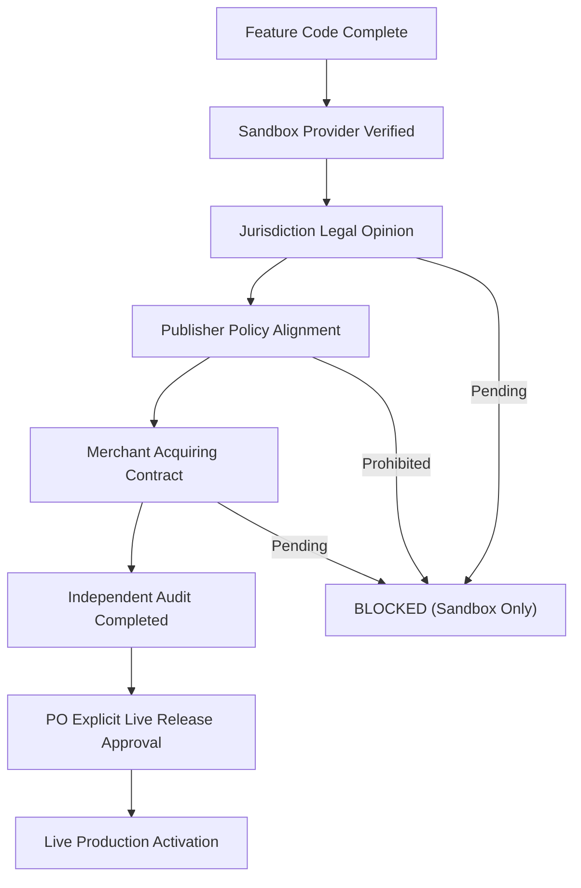

# 02. SCOPE AND RELEASE POLICY

**Document ID:** BN-DOC-002  
**Ref:** Master PO Execution Order BN-GAMEEX-MASTER-001 (Article 3 & 37)  

---

## 1. Commercial Release Policy & Guardrails

Per direct order of the Chief Product Owner, commercial release of BN GAMEEX follows a strict **Staged Regulatory Gate**:

---

## 2. In-Scope vs Blocked Features Matrix

| Feature Domain | Technical Implementation | Commercial Live Status | Release Condition |
| :--- | :--- | :--- | :--- |
| **Transferable Game Items** | 100% Implemented (Go API / Vue / Flutter) | **APPROVED (Selected Games)** | Pre-cleared game titles only |
| **Official Gift Codes** | 100% Implemented (Code receipt & verification) | **APPROVED (Authorized Retail)** | Publisher licensing validation |
| **Game Currency Trading** | 100% Modeled in schema & policy engine | **BLOCKED (Default)** | Requires Korean Game Act & AML compliance review |
| **Game Account Trading** | Explicitly blocked in PolicyEngine | **PROHIBITED** | Prohibited under Article 3.4 in v1.0 |
| **Payment Sandbox** | Fully implemented with HMAC signature verification | **ACTIVE (Sandbox)** | Operates in dev/staging |
| **Live Payment Capture** | Provider adapter ready for live keys | **BLOCKED (Awaiting Contract)** | Requires countersigned PSP agreement |
| **Seller Payouts** | Adapter ready for bulk transfer API | **BLOCKED (Awaiting Contract)** | Requires payout service onboarding |
