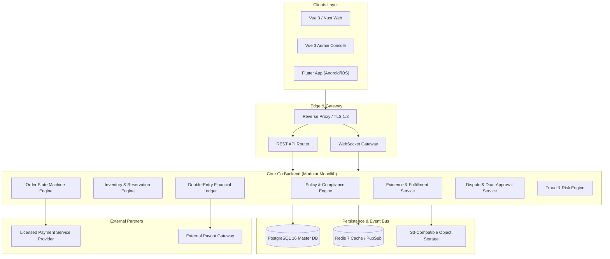

# 13. SYSTEM ARCHITECTURE

**Document ID:** BN-DOC-013  
**Ref:** Master PO Execution Order BN-GAMEEX-MASTER-001 (Article 5)  

---

## 1. High-Level Architecture Diagram

---

## 2. Security Boundaries & Zero-Trust Invariants
1. **Network Isolation:** Database and internal services are only accessible from backend container networks.
2. **Idempotency Enforcement:** All order creation, payment capture, and refund webhooks require unique idempotency keys.
3. **No Direct Ledger Tampering:** Database balance columns cannot be manually incremented; all adjustments must originate from a verified balanced double-entry transaction.

