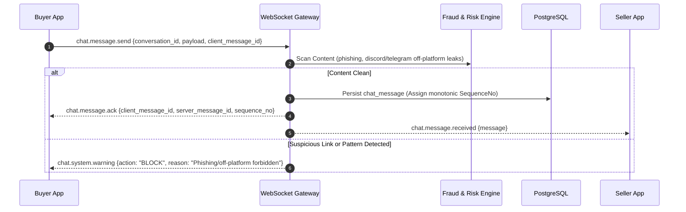

# 17. REAL-TIME WEBSOCKET PROTOCOL SPECIFICATION

**Document ID:** BN-DOC-017  
**Ref:** Master PO Execution Order BN-GAMEEX-MASTER-001 (Article 14)  

---

## 1. Connection & Authentication
- Endpoint: `GET /api/v1/ws/chat?user_id={UUID}`
- Protocol: RFC 6455 WebSocket Upgrade
- Handshake validates session token or user identity against active session repository.

---

## 2. Event Dispatch Flow

