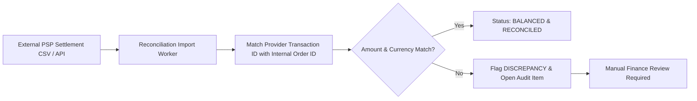

# 22. FINANCIAL RECONCILIATION & AUDIT

**Document ID:** BN-DOC-022  
**Ref:** Master PO Execution Order BN-GAMEEX-MASTER-001 (Article 27.10)  

---

## 1. Reconciliation Process
Financial operations regularly ingest batch payout and settlement reports from PSP partners:

---

## 2. Anti-Tampering Rules
- Internal ledger transactions are append-only.
- Discrepancies cannot be automatically closed without a formal review note and secondary management signoff.
