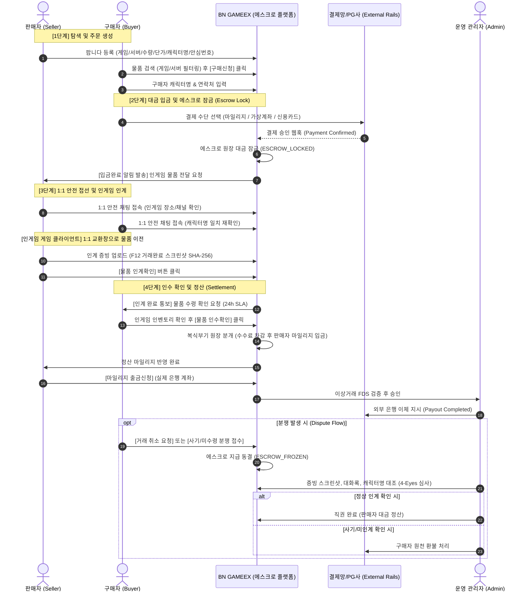

# 🌍 BN GAMEEX — BAROTEM & ITEMMANIA BENCHMARK & USER FLOW ANALYSIS
## 국내 대표 게임 아이템 중개 플랫폼 심층 분석 및 엔터프라이즈 거래 프로세스 명세서

**문서 번호:** BN-DOC-39  
**참조 규격:** BN-GAMEEX-MASTER-001 / ARTICLE 2 (벤치마킹), ARTICLE 11~17 (거래·인계·에스크로)  
**분석 대상:** 바로템 (BaroTem.com), 아이템매니아 (ItemMania.com), 아이템베이 (ItemBay.com)  
**작성일자:** 2026-10-27  
**작성자:** BN GAMEEX 프로덕트 & 컴플라이언스 아키텍처팀  

---

# SECTION 1. 벤치마킹 개요 및 플랫폼별 특성 비교

대한민국 디지털 게임 자산 중개 시장을 양분하는 **전통적 PC 온라인 중심 플랫폼(아이템매니아/아이템베이)**과 **모바일 게임 중심 신흥 플랫폼(바로템)**을 심층 조사하여 각 사의 거래 플로우, 안전 장치, 자금 정산 체계를 분석한다.

```
┌────────────────────────────────────────────────────────────────────────────────────────┐
│                                   플랫폼 핵심 지표 비교                                │
├──────────────────┬─────────────────────────────┬───────────────────────────────────────┤
│ 항목             │ 아이템매니아 (ItemMania)     │ 바로템 (BaroTem)                      │
├──────────────────┼─────────────────────────────┼───────────────────────────────────────┤
│ 주력 분야        │ PC 온라인 RPG (리니지, 로아,│ 모바일 RPG / 수집형 RPG / 계정·캐릭터 │
│                  │ 메이플, 던파, 디아블로 등)  │ (리니지M, 오딘, 나이트크로우 등)      │
├──────────────────┼─────────────────────────────┼───────────────────────────────────────┤
│ 거래 물품 카테고리│ 게임머니, 일반 아이템,      │ 게임머니, 아이템, 캐릭터/계정, 구글기프트│
│                  │ 캐릭터/계정, 패키지         │ 마일리지 거래                         │
├──────────────────┼─────────────────────────────┼───────────────────────────────────────┤
│ 판매 수수료      │ 거래금액의 5% (최대 47,000원│ 거래금액의 3~5% (카테고리별 차등,      │
│                  │ 상한제 적용)                │ 계정 거래의 경우 정액/정률제)         │
├──────────────────┼─────────────────────────────┼───────────────────────────────────────┤
│ 구매자 수수료    │ 0% (무료, 충전 수수료 별도) │ 0% (무료, 충전 수수료 별도)           │
├──────────────────┼─────────────────────────────┼───────────────────────────────────────┤
│ 자금 결제/보관   │ 자체 마일리지 (선불전자지급)│ 자체 마일리지 (선불전자지급)          │
│                  │ + 에스크로 예치             │ + 24시간 실시간 즉시 출금 지원        │
├──────────────────┼─────────────────────────────┼───────────────────────────────────────┤
│ 주요 안전 장치   │ 200% 보상제도, 안심번호,    │ 200% 안심보상, 전자계약서 작성,       │
│                  │ 신용등급(VIP/플래티넘),     │ KCB 본인인증, 더치트 사기이력 조회,   │
│                  │ 출금 지연제 (사기 방지)     │ 1대 본주 인증 마크                    │
├──────────────────┼─────────────────────────────┼───────────────────────────────────────┤
│ 인계 확인 방식   │ 판매자 인계확인 클릭        │ 판매자 인계확인 + 인계 스크린샷 첨부   │
│                  │ $\rightarrow$ 구매자 인수확인│ $\rightarrow$ 구매자 인수확인         │
│                  │ (미확인 시 24시간 후 자동완료)│ (미확인 시 자동 완료 타이머)          │
└──────────────────┴─────────────────────────────┴───────────────────────────────────────┘
```

---

# SECTION 2. 실거래 End-to-End User Flow 분석

아이템매니아와 바로템의 공통적이면서도 엄격한 에스크로(Escrow) 기반 14단계 유저 플로우를 상세 명세한다.



---

# SECTION 3. 역할별(Seller, Buyer, Admin) 필수 행동 및 기능 정의

## 3.1 판매자 (Seller)의 필수 행동 및 기능
1. **판매 물품 등록 (Sell Listing Registration):**
   * 게임 및 서버 선택 (예: 던전앤파이터 $\rightarrow$ 카인, 메이플스토리 $\rightarrow$ 스카니아)
   * 물품 종류 선택: 게임머니 (골드/메소/다이아), 일반 아이템, 패키지/바우처
   * 판매 수량 및 분할판매 여부 설정: 일괄 판매(All-or-Nothing) vs 최소 분할 단위
   * 단가 및 총 판매금액 입력
   * **인게임 판매 캐릭터명 입력** (사칭 사기 방지의 핵심)
   * 거래 가능 시간대 지정 (즉시거래 / 예약거래)
   * 200% 안심보상 가입 여부 선택
2. **입금 알림 수신 및 거래 확인:**
   * 구매자가 에스크로 입금을 완료하기 전까지는 **절대 인게임 물품을 넘기지 않아야 함** (시스템에서 "입금완료" 상태 확인 필수)
3. **인게임 물품 전달 (Handover):**
   * 구매자 캐릭터명 정확히 대조 (한 글자 오타, 특수문자 사칭 주의)
   * 인게임 귓속말로 아이템매니아/바로템/거래번호 언급 금지 (게임사 제재 방지)
4. **인계 완료 통보 및 스크린샷 증빙:**
   * 게임 내 교환 완료 창 스크린샷 캡처
   * 플랫폼에 파일 업로드 (SHA-256 자동 계산 및 타임스탬프 각인)
   * [물품 인계확인] 버튼 클릭
5. **정산 및 마일리지 출금:**
   * 구매자 인수확인 완료 후 정산된 마일리지 확인
   * 본인 명의 등록 계좌로 실시간 출금 신청

## 3.2 구매자 (Buyer)의 필수 행동 및 기능
1. **물품 탐색 및 조건 비교:**
   * 게임/서버/물품 종류별 단가 비교 (1만당 골드 단가 등)
   * 판매자의 신용등급, 거래건수, 200% 보상 마크, 최근 거래 성공률 확인
2. **구매 신청 및 에스크로 대금 결제:**
   * 구매 수량 선택
   * 본인의 **인게임 수령 캐릭터명** 정확히 입력
   * 마일리지 또는 외부 결제 수단으로 100% 대금 예치
3. **1:1 거래 대기 및 인게임 수령:**
   * 판매자와 1:1 전용 채팅으로 접속하여 만날 채널/좌표 조율
   * 인게임에서 판매자 캐릭터명이 일치하는지 확인 후 교환 수락
4. **물품 인수확인 (구매확정):**
   * 인게임 인벤토리에 정상 입고되었는지 검수
   * [물품 인수확인] 버튼 클릭 $\rightarrow$ 에스크로가 판매자에게 즉시 해제됨
   * **경고 준수:** 거래 직후 "잘못 전달했으니 돌려달라"는 인게임 귓속말은 100% 사기꾼이므로 절대 돌려주지 않음
5. **문제 발생 시 즉시 거래취소 또는 분쟁 접수:**
   * 판매자가 1시간 이상 미접속/미응답 시 [거래 취소 요청]
   * 판매자가 엉뚱한 수량을 넘겼거나 허위 인계확인을 눌렀을 경우 [거래 사고 접수] 클릭하여 에스크로 지급 동결

## 3.3 운영 관리자 (Admin / Operator)의 필수 행동 및 기능
1. **실시간 거래 중개 관제 (Live Trade Monitoring):**
   * `PAYMENT_CONFIRMED` 이후 장시간(예: 2시간) 인계가 안 된 정체 건 모니터링
   * 판매자 인계확인 후 24시간 동안 구매자가 인수확인을 안 누른 건에 대한 자동완료 타이머 감시
2. **분쟁 조정 및 중재 (Dispute Resolution):**
   * 구매자 취소 요청 시 판매자 동의 여부 확인 (미인계 상태 확인 후 직권 취소)
   * 사기 분쟁 발생 시 양측 채팅 로그, 판매자 제출 SHA-256 스크린샷, 인게임 캐릭터명 대조
   * 4-Eyes 원칙(조사관 검토 $\rightarrow$ 금융 승인권자 서명)에 의거한 직권 취소(환불) 또는 직권 완료
3. **마일리지 출금 심사 (Withdrawal Approval):**
   * 비정상 급증 거래, 신규 가입자 고액 출금, 더치트/FDS 블랙리스트 계좌 자동 필터링
   * 24시간 실시간 펌뱅킹 이체 승인 및 오류 대사
4. **불법/위반 물품 제재:**
   * Article 3.4 계정 거래, 불법 복제머니, 사설서버 물품 즉시 게시 중단 및 이용자 정지

---

# SECTION 4. 바로템 / 아이템매니아 대응 확장 DB 스키마 설계

기존 34개 마스터 테이블에 더하여, 국내 P2P 거래 플랫폼의 특화 요소(마일리지 지갑, 출금신청, 팝니다/삽니다 구분, 200% 보상제도, 거래취소 요청서)를 지원하는 `002_barotem_itemmania_features.sql` 스키마를 도출한다.

1. `trade_articles`: 팝니다(SELL) / 삽니다(BUY) 통합 게시글 원장 (분할판매, 안심번호, 최소/최대수량, 캐릭터명)
2. `user_mileage_wallets`: 유저별 마일리지 잔액, 출금가능 잔액, 거래 보증금, 거래 잠금(에스크로) 잔액
3. `mileage_transactions`: 마일리지 충전, 에스크로 차감, 거래 수수료, 정산 입금, 출금 불변 거래 원장
4. `mileage_withdrawal_requests`: 실시간 은행 계좌 출금 신청 및 FDS 감사 원장
5. `trade_cancellation_requests`: 거래 취소 요청, 사유, 상대방 동의 여부, 관리자 직권 처리 기록
6. `safety_warranty_claims`: 200% 안심보상 접수 및 보험금 지급 심사 원장

---

# SECTION 5. 결론 및 구현 지침

본 분석 결과를 바탕으로, 사용자는 **아이템매니아의 신속한 거래 탭/단가 계산 방식**과 **바로템의 모던한 안심보상/24시간 실시간 마일리지 정산 경험**을 결합한 최상급 P2P 게임 자산 거래 플랫폼을 경험하게 된다.
이상의 설계를 바탕으로 데이터베이스 마이그레이션 SQL 및 웹/어드민 실서비스 구현을 즉시 개시한다.

